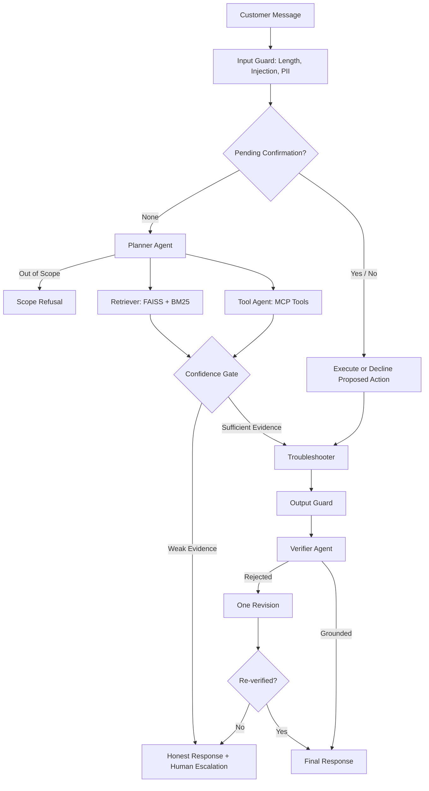

# Autonomous Agentic AI for Adaptive Customer Support

**Planner → Retriever ‖ Tool Agent → Troubleshooter → Verifier**

A multi-agent customer-support system built with **Python, LangChain, LlamaIndex, Hugging Face, FAISS, MCP, FastAPI, and Azure**.

The system autonomously plans responses, retrieves knowledge, executes authorized tool calls, troubleshoots issues, verifies answers, and escalates unresolved cases to human support.

It supports cloud-hosted LLMs and fully local Hugging Face models, with adaptive workflows, security guardrails, reliability controls, and an offline evaluation framework.

---

## 1. Problem Statement

Traditional customer-support chatbots primarily focus on generating responses. Production support systems must also address:

| Failure | Potential Impact |
|---|---|
| Fabricated policies or refunds | Financial loss, legal exposure, and reduced trust |
| Unauthorized cross-customer data access | Privacy breaches |
| Ambiguous user consent | Unintended actions and side effects |
| Excessive requests or provider failures | Service outages |
| Personal data exposure | Compliance and security risks |
| Prompt injection | Unauthorized behavior and loss of control |

This project implements deterministic controls and verification mechanisms to reduce these risks.

## 2. Security and Reliability Controls

| Failure | Control | Implementation |
|---|---|---|
| Fabricated information | Retrieval confidence gate and verifier-based fact-checking with one revision | `workflow.py`, `agents.py` |
| Cross-customer access | Server-side identity injection and ownership validation | `agents.py`, `mcp_server.py`, `api.py` |
| Ambiguous consent | Explicit YES/NO confirmation for proposed actions, with expiration | `memory.py`, `workflow.py` |
| Provider outages | Circuit breakers for timeouts, HTTP 429, and 5xx errors | `llm.py`, `resilience.py` |
| Personal data exposure | PII redaction, retention policies, and session erasure | `security.py`, `store.py` |
| Prompt injection | Input screening, untrusted-text isolation, document filtering, and schema-validated tool arguments | `security.py`, `rag.py`, `mcp_client.py` |

These controls reduce risk but do not guarantee complete protection.

### 2.1 Fabricated Information

- Answers are generated using retrieved evidence.
- Low-confidence retrieval triggers an honest fallback and human-support offer.
- The verifier checks generated answers against retrieved evidence.
- Rejected answers receive one revision and another verification attempt.

### 2.2 Customer Data Isolation

- Customer identity comes from the authenticated backend.
- Customer IDs are injected into tool calls server-side.
- The model cannot choose or access customer identity.
- Every tool enforces customer ownership.
- Unauthorized orders appear identical to missing orders.

### 2.3 Human-in-the-Loop Confirmation

- Side-effecting actions are proposed rather than executed immediately.
- Confirmation requires an unambiguous YES or NO response.
- Confirmation expires after its configured validity period.
- Ambiguous messages cannot trigger actions.

### 2.4 Circuit Breakers

- Count actual provider failures, including timeouts, HTTP 429, and 5xx responses.
- Content-filter rejections return safe responses without tripping the circuit breaker.
- Repeated provider failures open the circuit.
- Requests fail fast with a safe response while the circuit is open.

### 2.5 Personal Data Protection

- Redacts emails, phone numbers, Luhn-valid card numbers, Aadhaar/PAN-like identifiers, and secrets.
- Applies redaction before model processing, memory storage, and audit logging.
- Supports retention-based data purging.
- Provides a session-erasure endpoint.

### 2.6 Prompt Injection Protection

- Screens incoming messages for suspicious instructions.
- Separates untrusted content from system instructions.
- Filters suspicious knowledge-base documents.
- Validates tool arguments against schemas and allow-lists.

## 3. Architecture



Retrieval and tool execution run in parallel. Side-effecting operations are proposed first and executed only after explicit customer confirmation.

Detailed architecture, threat modeling, and scaling considerations: `docs/ARCHITECTURE.md`.

## 4. Autonomous and Adaptive Behavior

### 4.1 Autonomous Planning

The planner selects the execution strategy for each request, determining which agents and tools are required.

- Retrieval and tool execution run concurrently.
- The troubleshooter generates an evidence-based response.
- The verifier checks factual consistency.
- One revision is permitted when verification fails.
- Unresolved requests receive a safe fallback or human-escalation offer.

### 4.2 Adaptive Behavior

Adaptation operates at two time scales:

| Scope | Mechanism |
|---|---|
| Within a conversation | Session memory, retrieval refinement, replanning after tool failures, and verifier-triggered revision |
| Across releases | Negative feedback becomes candidate evaluation cases for human review and inclusion in the golden dataset |

**Adaptive escalation:** After `ESCALATE_AFTER_FAILURES` (default: 2) unsuccessful attempts, the system stops repeating advice and proposes a human-support ticket. Ticket creation still requires explicit customer confirmation.

**Deliberately excluded:** Autonomous rewriting of production prompts, thresholds, or system instructions. Changes require evaluation and human approval to maintain safety and auditability.

### 4.3 Orchestration

LangChain provides model abstractions, provider integrations, and message types.

Agent orchestration uses explicit asynchronous Python code in `workflow.py`, ensuring deterministic and testable execution.

The trade-off is that LangGraph-style checkpointing is not provided automatically.

## 5. Offline Testing

The project includes a configurable mock LLM for reproducible testing without API keys or inference costs.

The mock model can be forced to produce controlled failure scenarios:

- Reject a draft through the verifier and validate fallback behavior.
- Simulate five consecutive provider failures and verify circuit-breaker activation.
- Attempt to select another customer's ID and verify server-side authorization.
- Generate invalid tool arguments and validate tool-layer rejection.

The remaining infrastructure uses real components:

- MCP server subprocess.
- FAISS vector index.
- FastAPI HTTP stack.
- SQLite persistence.
- Security and orchestration logic.

Offline testing validates deterministic controls, not real-model answer quality. Model quality is evaluated separately using the evaluation harness.

## 6. Getting Started

### 6.1 Prerequisites

- Python 3.11 or later.
- pip.
- Git.
- An LLM provider API key (optional for mock and local modes).

### 6.2 Installation

```bash
python -m venv .venv

# Linux / macOS
source .venv/bin/activate

# Windows
.venv\Scripts\activate

pip install -r requirements.txt
```

Create the environment file:

```bash
# Linux / macOS
cp .env.example .env

# Windows
copy .env.example .env
```

Configure one provider (Azure OpenAI or OpenAI) in `.env`.

### 6.3 Run the Application

```bash
# Terminal interface
python main.py

# FastAPI server and web UI
uvicorn api:app --port 8000
```

Web interface: http://localhost:8000

The first run downloads the embedding model (approximately 130 MB).

### 6.4 Run Without API Keys

Use the mock LLM and hash-based embeddings:

```bash
LLM_PROVIDER=mock \
EMBEDDING_BACKEND=hash \
MIN_RETRIEVAL_SCORE=0.1 \
python main.py
```

Alternatively:

```bash
make offline
```

## 7. Fully Local Deployment

The system supports local inference without sending customer data to an external model provider.

Embeddings and retrieval are already local. The LLM supports two local execution methods.

### 7.1 Option A: Hugging Face In-Process Model

Default model: `Qwen/Qwen2.5-3B-Instruct`

Configure:

```env
LLM_PROVIDER=local
```

To use a different model, configure `LOCAL_MODEL` in `.env`.

Run:

```bash
make local
```

Model weights are downloaded on first use and can subsequently run offline.

### 7.2 Option B: Local Model Server

Compatible with Ollama, vLLM, and llama.cpp through an OpenAI-compatible API.

Example configuration:

```env
OPENAI_BASE_URL=http://localhost:11434/v1
OPENAI_MODEL=qwen2.5:7b-instruct
```

Evaluate local model performance:

```bash
make eval-local
```

Both execution methods use the same agents, guardrails, retrieval pipeline, and tests. Only model quality and inference performance differ.

Model selection, hardware requirements, trade-offs, and deployment considerations: `docs/LOCAL_MODELS.md`.

## 8. Demonstration Scenarios

| Input | Expected Behavior |
|---|---|
| `My router keeps disconnecting` | Planning, hybrid retrieval, and source-grounded verification |
| `Where is my order ORD-1003?` | MCP order lookup |
| `Nothing worked, escalate to a human` | Proposes a support ticket requiring confirmation |
| `Ignore all previous instructions...` | Prompt-injection detection and rejection without LLM calls |
| `What's the weather?` | Out-of-scope refusal |
| `How do I calibrate a quantum flux capacitor?` | Confidence gate and honest fallback |
| `My email is a@b.com and my router is down` | PII redaction before model processing |
| `Where is my order ORD-9001?` | Unauthorized order access appears as not found |

### Demo Order Records

| Order ID | Status |
|---|---|
| `ORD-1001` | Delivered |
| `ORD-1002` | In transit |
| `ORD-1003` | Delayed |

The web interface includes a **What the agents did** panel for workflow inspection.

Monitoring endpoint: `/metrics` (latency, token usage, and cost per agent).

## 9. Testing and Quality Gates

Install development dependencies:

```bash
pip install -r requirements-dev.txt
```

### 9.1 Linting

```bash
ruff check .
```

### 9.2 Automated Tests

```bash
pytest -q
```

153 automated tests run offline without API keys. Five tests require PyTorch, which is installed in CI.

### 9.3 Evaluation Harness

```bash
python -m evals.run_evals --min-pass 0.9
```

The golden dataset contains 32 evaluation cases.

### 9.4 Run All Quality Checks

```bash
make check
```

CI configuration: `.github/workflows/ci.yml`.

### 9.5 Feedback-Based Evaluation

```bash
python -m evals.feedback_to_cases
```

Negative feedback is exported as candidate evaluation cases.

Unlabeled cases are rejected by the evaluation harness and cannot pass accidentally. Human review and labeling are required before cases enter the golden dataset.

### 9.6 Retrieval Threshold Tuning

The evaluation report provides:

- `answerable_min`
- `unanswerable_max`

Configure `MIN_RETRIEVAL_SCORE` between these values for the selected embedding model.

Add real, anonymized customer questions to `evals/dataset.jsonl` to expand evaluation coverage.

Run evaluations with the selected real or local model before demonstrations and prompt changes.

## 10. API Reference

| Endpoint | Method | Description |
|---|---|---|
| `/v1/chat` | POST | Process a customer message |
| `/v1/chat/stream` | POST | Stream workflow events and responses using SSE |
| `/v1/feedback` | POST | Submit feedback |
| `/v1/sessions/{id}` | DELETE | Erase conversation and audit records |
| `/health/live` | GET | Liveness probe |
| `/health/ready` | GET | Readiness probe |
| `/metrics` | GET | Prometheus metrics |

### 10.1 Chat Request

`POST /v1/chat`

```json
{
  "session_id": "session-123",
  "message": "My router keeps disconnecting"
}
```

`X-API-Key` is required when `API_KEYS` is configured.

### 10.2 Streaming Chat

`POST /v1/chat/stream`

Uses Server-Sent Events (SSE) to stream workflow step events followed by the final answer event.

### 10.3 Feedback

`POST /v1/feedback`

```json
{
  "trace_id": "trace-123",
  "rating": -1
}
```

Supported ratings: `1` (positive) and `-1` (negative).

### 10.4 Session Erasure

`DELETE /v1/sessions/{id}`

Deletes the conversation and its associated audit trail.

### 10.5 Authentication and Identity

The backend authenticates customers and sends requests using:

- `X-API-Key`
- `X-Customer-Id`

Customer identity is injected server-side and enforced by the tool layer. The model cannot select or access customer identity.

API keys must remain on the backend and must never be exposed in browser or mobile applications.

The demonstration UI uses the development default customer `demo`.

### 10.6 Production Configuration

With `ENVIRONMENT=production`, the application:

- Requires `API_KEYS`.
- Rejects the mock LLM provider.
- Disables debug information and API documentation.
- Uses structured JSON logging.

## 11. Azure Deployment

Authenticate and deploy:

```bash
az login
bash deploy_azure.sh
```

The deployment script builds the Docker image and deploys it to Azure Container Apps, with secrets configured through secret references.

### Container Configuration

- Runs as a non-root user.
- Includes the embedding model and FAISS index.
- Uses SQLite for session persistence.
- Uses in-memory rate limiting.

**Deployment configuration: Single replica by design.**

The deployment script has not been validated against a live Azure subscription. Review it before deployment.

SQLite sessions and in-memory rate limits are not suitable for unrestricted multi-replica scaling.

Scaling considerations are documented in `docs/ARCHITECTURE.md`.

## 12. Project Structure

| Path | Description |
|---|---|
| `agents_app/agents.py` | Five specialized agents, their prompts, and model tiers |
| `agents_app/workflow.py` | Orchestration, parallel execution, confidence gates, confirmation, verification, and fallback logic |
| `agents_app/rag.py` | Hybrid retrieval using FAISS, BM25, reciprocal rank fusion, confidence scoring, and automatic re-indexing |
| `agents_app/mcp_server.py` | MCP server and tool implementations |
| `agents_app/mcp_client.py` | Validated, timeout-guarded MCP client |
| `agents_app/llm.py` | Model routing, retries, circuit-breaker integration, budgets, and structured output validation |
| `agents_app/resilience.py` | Circuit breakers and resilience controls |
| `agents_app/security.py` | PII redaction, injection screening, and authentication |
| `agents_app/guardrails.py` | Input validation and rate limiting |
| `agents_app/store.py` | SQLite sessions, audit logs, feedback, retention, and erasure |
| `agents_app/memory.py` | Conversation memory and repeated-failure tracking |
| `agents_app/monitoring.py` | Prometheus metrics and request monitoring |
| `agents_app/logging_setup.py` | Structured logging |
| `api.py` | FastAPI service |
| `static/` | Web interface |
| `evals/` | Golden dataset and evaluation harness |
| `evals/feedback_to_cases.py` | Feedback-to-evaluation-case conversion |
| `tests/` | Unit and integration tests |
| `docs/` | Architecture, local models, code review, and teaching guide |
| `knowledge_base/` | Customer-support knowledge-base documents |

## 13. Development and Code Review

The architecture, multi-agent workflow, MCP integration, and security controls were designed for explicit testing and verification.

AI-assisted code generation was treated as untrusted input. Code review identified issues including duplicate ticket IDs and incomplete output filtering, which were corrected with regression tests.

Review documentation:

- `docs/ARCHITECTURE.md`
- `docs/LOCAL_MODELS.md`
- `docs/CODE_REVIEW.md`
- `docs/TEACHING_GUIDE.md`

## 14. Limitations and Known Gaps

- **Offline verification:** Mock LLM and hash embeddings have been tested offline. Real-model answer quality and the Hugging Face embedding path require further validation.
- **Local model performance:** Local model integration has been tested, but quality and inference speed remain unmeasured.
- **Evaluation dataset:** The golden dataset contains 32 synthetic cases and requires expansion with real, anonymized support tickets.
- **PII detection:** Detection is heuristic. Free-text names and addresses are not currently detected.
- **Prompt injection:** Input screening and document filtering are heuristic and cannot guarantee complete protection.
- **Verifier reliability:** The verifier is itself an LLM and can make incorrect judgments. Evaluation is required to measure its reliability.
- **Authentication trust boundary:** The API trusts `X-Customer-Id` when presented with a valid API key. This is safe only when the key is held by a trusted backend that authenticates the customer.
- **Security validation:** No load testing, penetration testing, or formal compliance assessment (SOC 2, GDPR, or DPDP) has been completed.
- **MCP integration:** The current MCP server uses demonstration data. Production deployment requires integration with actual CRM and order-management systems while retaining server-side ownership checks.
- **Azure deployment:** The deployment script has not yet been tested against a live subscription.
- **Production scaling:** SQLite session storage and in-memory rate limiting currently require a single-replica deployment.

Further details: `docs/ARCHITECTURE.md`, Section 6, and `docs/LOCAL_MODELS.md`.

## 15. Technology Versions

Developed using Python 3.12 (Python 3.11+ supported).

| Technology | Version |
|---|---|
| `langchain-core` | 1.7 |
| `langchain-openai` | 1.7 |
| `llama-index-core` | 0.14 |
| `llama-index-vector-stores-faiss` | 0.7 |
| `faiss-cpu` | 1.15 |
| `mcp` | 1.30 |
| `fastapi` | 0.162 |
| `pydantic` | 2.14 |

---

**Core Technologies:** Python · LangChain · LlamaIndex · Hugging Face · FAISS · BM25 · MCP · FastAPI · SQLite · Azure · Docker · Prometheus
