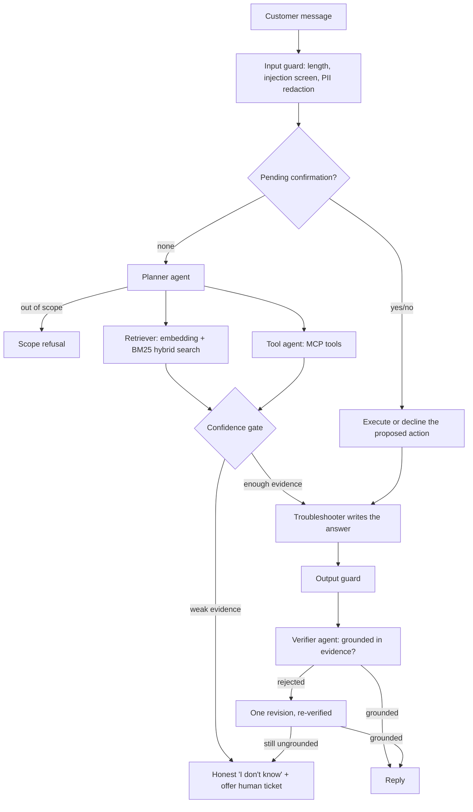

# Autonomous Agentic AI for Adaptive Customer Support

**Planner → Retriever ‖ Tool agent → Troubleshooter → Verifier.** A multi-agent customer-support system built with Python · FastAPI · asyncio · SQLite · optional Hugging Face / OpenAI-compatible models. The model can be a cloud API or a model running entirely on your own machine.

A planner, retriever, tool agent, troubleshooter and verifier work together to answer support questions, look up orders, and escalate to a human. The agents decide their own plan per request (**autonomous**), change strategy when their advice keeps failing (**adaptive**), and sit inside guardrails, reliability controls and an evaluation harness.

---

## The problem

Most chatbot demos only show the model answering. In customer support, the expensive failures are not wrong tone or a clumsy sentence. They are:

| Failure | What it costs |
| :--- | :--- |
| Inventing a policy or refund the company never offered | Money, trust, legal exposure |
| Showing one customer another customer's order | Privacy breach |
| Acting on an ambiguous "yes" (for example, "yes but what does it cost?" creates a ticket) | Unwanted side effects |
| One hostile user taking the service down for everyone | Outage |
| Leaking personal data into logs, memory or the model provider | Compliance risk |
| Obeying instructions hidden in a message or document (prompt injection) | Loss of control |

This project puts a specific, testable control against each of these.

---

## How each failure is handled

| Failure | Control | Where |
| :--- | :--- | :--- |
| **Invented policy** | Confidence gate (answers only from retrieved evidence, otherwise says "I don't know" and offers a human), plus a verifier agent that fact-checks the draft against the evidence and triggers one revision | `workflow.py`, `agents.py` |
| **Cross-customer data access** | Server-side identity: the customer ID comes from the authenticated caller, is injected into tool calls, hidden from the model, and enforced inside each tool. A foreign order looks exactly like a missing one | `agents.py`, `mcp_server.py`, `api.py` |
| **Ambiguous consent** | Human-in-the-loop: side-effecting actions are only proposed. The whole message must be an unambiguous yes/no, and the confirmation expires | `memory.py`, `workflow.py` |
| **One user causing an outage** | Circuit breakers count only real outages (timeouts, 429, 5xx). Content-filter rejections become a safe reply and never trip the breaker | `llm.py`, `resilience.py` |
| **Personal data exposure** | PII redaction (emails, phones, Luhn-valid cards, Aadhaar/PAN-like IDs, secrets) before the model, memory and audit log; retention purge; erasure endpoint | `security.py`, `store.py` |
| **Prompt injection** | Input screen, untrusted text fenced and sanitised in prompts, suspicious knowledge-base docs excluded, tool arguments schema-validated against an allow-list | `security.py`, `rag.py`, `mcp_client.py` |

*These are heuristics and controls that reduce risk. They do not eliminate it (see Limitations).*

---

## Why it is tested offline, and why that is a strength

Most of the controls above are deterministic logic, not model quality. A real LLM makes them harder to test: output varies between runs, and every run costs money. So the project ships a **mock LLM** that can be forced to misbehave on demand:

* Make the verifier reject a draft, then check the system falls back instead of shipping it.
* Make the provider fail five times in a row, then check the circuit opens and requests fail fast with a safe message.
* Make the "model" try to choose another customer's ID, then check the tool layer ignores it.

Everything else is real: an in-process MCP-compatible tool server (JSON-RPC), a real hybrid retrieval index over the local knowledge base, a real SQLite store, and a real HTTP stack. The result is a safety layer that is reproducible, free to run, and checked in CI with no API keys.

What offline testing does not prove is answer quality with a real model. That is measured separately by the eval harness (`make eval`) and is listed under known gaps.

---

## Architecture



Retrieval and tool calls run in parallel. Write actions are never executed directly: they are proposed first and run only after the customer confirms. Full design, threat model and scaling notes are in `docs/ARCHITECTURE.md`.

---

## What "autonomous" and "adaptive" mean here

Both words are easy to oversell, so here is exactly what the code does.

* **Autonomous:** Given a customer message, the planner chooses the plan (which agents run, whether a live tool is needed), retrieval and tool calls run in parallel, the verifier checks the draft and triggers one revision, and failures end in a safe reply. A human is only involved for side-effecting actions, by design.
* **Adaptive:** Operates at two time scales, deliberately not a third one:

| Scale | What adapts | Mechanism |
| :--- | :--- | :--- |
| **Within a conversation** | Wording, retrieval and strategy | Session memory (e.g. the remembered device sharpens retrieval), re-planning when a tool fails, one revision when the verifier rejects, and adaptive escalation: after `ESCALATE_AFTER_FAILURES` (default 2) reports like "still not working" the system stops repeating advice and offers a human ticket, which still needs the customer's YES |
| **Across releases** | Prompts, thresholds, test coverage | Feedback loop: thumbs-down turns are exported by `python -m evals.feedback_to_cases` as candidate eval cases that a person labels and adds to the golden dataset, so every real failure becomes a regression test |
| **Not done on purpose** | The system rewriting its own prompts or thresholds in production | Unreviewed self-modification is a safety and audit risk. Changes go through evals and a human |

The model layer is a thin adapter (`llm.py`) for Azure OpenAI, plain OpenAI or any OpenAI-compatible local server, an in-process Transformers pipeline, or the deterministic mock. The orchestration itself is explicit `asyncio` code in `workflow.py`, which keeps every step testable and deterministic. The trade-off is that you do not get graph-style checkpointing for free.

---

## Quick start

```bash
python -m venv .venv && source .venv/bin/activate      # Windows: .venv\Scripts\activate
pip install -r requirements.txt
cp .env.example .env                                   # Windows: copy .env.example .env
# open .env and fill in ONE provider (Azure OpenAI or OpenAI), then:
python main.py                                         # terminal chat
uvicorn api:app --port 8000                            # web UI at http://localhost:8000 + API
```

The base install uses a deterministic hash embedder, so the first run needs no model download. For Hugging Face embeddings or an in-process local LLM, install the optional extras: `pip install -r requirements-local.txt` (about 130 MB for the default embedding model, plus the model you choose).

For a persistent FAISS index or LlamaIndex sentence-aware chunking, install the opt-in RAG extras: `pip install -r requirements-rag.txt`, then set `VECTOR_STORE=faiss` and/or `INGEST_BACKEND=llamaindex`. The default stays the dependency-free built-in path, so the base install and the offline tests are unchanged.
